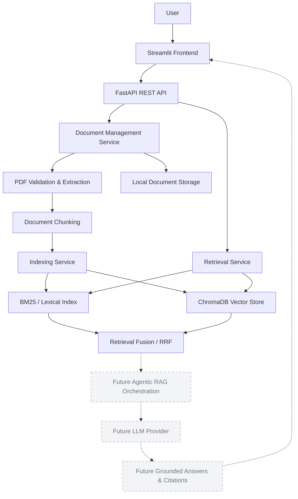

# Enterprise AI Document Assistant

### From business documents to intelligent, evidence-based answers.

**Enterprise AI Document Assistant** is an enterprise-oriented document intelligence platform designed to help organizations transform unstructured documents into searchable, actionable knowledge.

The platform enables users to upload and manage PDF documents, extract and index their content, and retrieve relevant information through a unified web interface. Its architecture is designed to evolve into an **Agentic RAG system**, where AI agents can orchestrate retrieval tools, analyze evidence across documents, and generate reliable, source-grounded answers.

Built as an independent AI engineering portfolio project, the application focuses on **modular architecture, hybrid information retrieval, extensibility, reproducibility, and enterprise-oriented engineering practices**.

> **Development status:** Active development. Document management, PDF extraction, chunking, indexing, lexical retrieval, and the retrieval infrastructure are implemented. Real semantic embeddings, LLM-generated answers, source-grounded conversational responses, and agentic orchestration are planned for upcoming milestones.

---

## 1. The Problem

Organizations accumulate large volumes of unstructured information in technical documentation, internal procedures, manuals, policies, and reports.

Finding the right information often requires navigating multiple documents, manually searching for relevant passages, and interpreting fragmented content.

Traditional keyword search can identify matching terms, but it does not always capture user intent or connect information across different sources.

Enterprise AI Document Assistant is designed to address these challenges through a document intelligence workflow that combines:

- **Document ingestion** — structured processing of uploaded business documents.
- **Information retrieval** — identifying relevant passages using lexical and semantic search.
- **Evidence-based generation** — producing answers grounded in retrieved documents.
- **Agentic reasoning** — coordinating tools and multi-step information retrieval for more complex queries.

The long-term goal is to deliver a system that goes beyond simple document search and supports intelligent interaction with organizational knowledge.

---

## 2. Key Capabilities

### Document Management

**Implemented**

- PDF upload through a Streamlit web interface.
- Backend validation and document processing.
- Text extraction from PDF documents.
- Persistent local document storage.
- Document metadata and processing status.
- Document listing and status inspection.
- Error handling for invalid, encrypted, or malformed PDFs.

### Document Indexing & Retrieval

**Implemented**

- Deterministic document chunking.
- Page-aware text segmentation.
- Lexical retrieval using BM25.
- Embedded ChromaDB vector-store infrastructure.
- Retrieval modes designed for lexical, vector, and hybrid search.
- Reciprocal Rank Fusion (RRF) for combining retrieval results.
- Retrieval result metadata, including document and page references.
- Graceful fallback to lexical retrieval when vector search is unavailable.

**Current limitation:** Real document embeddings are not yet integrated. The current vector-store implementation uses placeholder vectors, and validated retrieval is lexical. Vector-based semantic retrieval and meaningful hybrid fusion require the embedding integration planned for the next milestone.

### LLM-Powered Document Question Answering

**Planned**

- Natural-language document questions.
- Configurable OpenAI-compatible LLM providers.
- Context construction from retrieved document passages.
- Grounded answer generation.
- Document and page-level citations.
- Explicit handling of insufficient evidence.
- Multi-document question answering.

### Agentic AI Workflows

**Planned**

The platform is intended to evolve from a conventional retrieval pipeline into an agentic document intelligence system.

Planned agent capabilities include:

- Dynamic selection of retrieval tools.
- Multi-step retrieval for complex questions.
- Query decomposition into smaller information needs.
- Evidence collection across multiple documents.
- Iterative retrieval when additional context is required.
- Source-grounded answer synthesis.
- Controlled execution with configurable limits and traceable decisions.

These agentic capabilities are architectural goals and are not part of the current implementation.

---

## 3. System Architecture

The platform follows a modular architecture separating the user interface, API layer, document processing, storage, retrieval, and future AI orchestration components.



**Architecture principles**

- **Separation of concerns:** Frontend, API, document services, and retrieval services are independently organized.
- **Provider extensibility:** Components are designed to accommodate different embedding and LLM providers.
- **Local-first development:** Core document management and lexical search run without paid API credentials.
- **Graceful degradation:** Lexical retrieval remains available when semantic retrieval is not configured.
- **Reproducible environments:** Locked Python dependencies and containerized services.
- **Testability:** Isolated services and automated backend, frontend, and integration tests.

For additional architecture details, see [Architecture Overview](docs/architecture/overview.md).

---

## 4. Technology Stack

| Layer | Technology | Purpose |
|---|---|---|
| Language | Python 3.12 | Core application development |
| Backend | FastAPI | REST API and service orchestration |
| Frontend | Streamlit | Document management and interactive UI |
| Document Processing | PDF extraction pipeline | Text extraction and document validation |
| Lexical Search | rank-bm25 | Keyword-based information retrieval |
| Vector Database | ChromaDB | Embedded vector storage infrastructure |
| Hybrid Retrieval | Reciprocal Rank Fusion | Combining retrieval rankings |
| Embedding Models | Configurable provider — planned | Semantic vector generation |
| LLM Integration | OpenAI-compatible APIs — planned | Grounded answer generation |
| Agent Orchestration | To be selected | Tool-driven and multi-step AI workflows |
| Dependency Management | uv | Python environment and dependency locking |
| Deployment | Docker / Docker Compose | Containerized execution |
| Testing | pytest | Automated quality assurance |
| Linting & Formatting | Ruff | Static checks and formatting |
| CI | GitHub Actions | Automated repository checks |

The architecture is intentionally provider-oriented to support future experimentation with hosted and self-hosted AI models.

---

## 5. Retrieval Architecture

The retrieval layer is designed to support both lexical and semantic search.

### Lexical Retrieval — BM25

BM25 ranks document chunks based on the statistical relevance of query terms.

This approach is particularly useful for:

- Technical terminology.
- Exact product or system names.
- Error messages and identifiers.
- Documentation containing specific keywords.

BM25 is currently the validated retrieval path.

### Semantic Retrieval — Vector Search

The vector retrieval infrastructure uses ChromaDB.

The intended workflow is:

1. Extract text from a document.
2. Split the document into retrievable chunks.
3. Generate embeddings for each chunk.
4. Store embeddings and metadata in the vector database.
5. Embed incoming queries.
6. Retrieve semantically related chunks.

**Current status:** ChromaDB storage infrastructure is implemented, but production-meaningful embeddings are not yet generated.

### Hybrid Retrieval — Reciprocal Rank Fusion

The system includes an RRF-based fusion component designed to combine lexical and semantic retrieval rankings.

Hybrid search aims to improve document discovery by combining exact-term relevance with semantic similarity.

```text
User Query
    |
    v
Retrieval Engine
    |
    +---------------------+
    |                     |
    v                     v
BM25 Search           Vector Search
(implemented)         (embeddings pending)
    |                     |
    +----------+----------+
               |
               v
       Reciprocal Rank Fusion
               |
               v
       Ranked Document Chunks
               |
               v
    Future Context Construction
               |
               v
       Future LLM Generation
               |
               v
       Answer with Citations
```

The retrieval architecture is designed to degrade gracefully when vector retrieval is not available.

For implementation details, see [Retrieval Contract](docs/contracts/retrieval.md).

---

## 6. Getting Started

### Prerequisites

- Python 3.12.
- [uv](https://docs.astral.sh/uv/).
- Docker and Docker Compose, for containerized execution.
- Git.

No paid LLM account is required to run the currently implemented document-management and lexical-retrieval features.

### Clone the Repository

```bash
git clone https://github.com/NunolacombaRebelo/enterprise-ai-document-assistant.git
cd enterprise-ai-document-assistant
```

### Environment Configuration

Create a local environment file from the provided template.

**Linux / macOS**

```bash
cp .env.example .env
```

**Windows PowerShell**

```powershell
Copy-Item .env.example .env
```

Review the configuration in `.env` before starting the application.

The project can start without an OpenAI API key for the currently implemented functionality.

Never commit `.env` files or real credentials.

### Option A — Docker Compose (Recommended)

Build and start the application:

```bash
docker compose up -d --build
```

Check service status:

```bash
docker compose ps
```

Open the services:

| Service | Default URL |
|---|---|
| Streamlit Frontend | http://localhost:8501 |
| FastAPI Backend | http://localhost:8000 |
| API Documentation | http://localhost:8000/docs |
| Health Check | http://localhost:8000/health |

Host ports are configurable through environment variables such as `API_PORT` and `FRONTEND_PORT`.

For example, with `API_PORT=18000` and `FRONTEND_PORT=18501`, the services are exposed on those respective host ports.

Stop the application:

```bash
docker compose down
```

### Option B — Native Python Execution

Install dependencies:

```bash
uv sync --locked
```

Start the FastAPI backend:

```bash
uv run uvicorn enterprise_ai_document_assistant.api.main:app --host 127.0.0.1 --port 8000
```

In a second terminal, start the frontend.

**Windows PowerShell**

```powershell
$env:PYTHONPATH = (Get-Location).Path
uv run streamlit run frontend/app.py
```

**Linux / macOS**

```bash
PYTHONPATH="$(pwd)" uv run streamlit run frontend/app.py
```

Ensure that the frontend API configuration points to the running backend.

For detailed setup instructions, see [Development Guide](docs/development.md).

---

## 7. API Overview

FastAPI provides REST endpoints for document management and information retrieval.

### Document Management

| Method | Endpoint | Description |
|---|---|---|
| GET | `/health` | Application health check |
| POST | `/documents` | Upload and process a PDF |
| GET | `/documents` | List stored documents |
| GET | `/documents/{id}` | Retrieve document metadata and status |

### Retrieval

| Method | Endpoint | Description |
|---|---|---|
| POST | `/documents/{id}/index` | Index an uploaded document |
| GET | `/index/status` | Inspect retrieval index status |
| POST | `/search` | Search indexed document chunks |

### Example: Search Indexed Documents

```bash
curl -X POST "http://localhost:8000/search" \
  -H "Content-Type: application/json" \
  -d '{
    "query": "How do I configure the application?",
    "top_k": 5
  }'
```

The response contains ranked results and supporting metadata from indexed documents.

Search results are evidence passages, not LLM-generated answers.

Interactive API documentation is available through the FastAPI `/docs` endpoint.

For API contracts, see [API Contract](docs/contracts/api.md).

---

## 8. Repository Structure

```text
enterprise-ai-document-assistant/
|
|-- .github/
|   `-- workflows/                 # Automated CI checks
|
|-- .kilo/                          # AI-assisted development rules and skills
|
|-- src/
|   `-- enterprise_ai_document_assistant/
|       |-- api/                    # FastAPI application and routes
|       |-- core/                   # Shared settings and configuration
|       `-- services/
|           |-- documents/          # Validation, extraction, persistence
|           `-- retrieval/          # Chunking, BM25, ChromaDB, fusion, indexing
|
|-- frontend/
|   |-- api/                        # Backend API client
|   |-- components/                 # Reusable UI components
|   |-- app.py                      # Streamlit entry point
|   |-- config.py                   # Frontend configuration
|   `-- state.py                    # UI state management
|
|-- tests/
|   |-- backend/                    # Backend and retrieval tests
|   |-- frontend/                   # Frontend tests
|   `-- integration/                # Integration tests
|
|-- docker/                          # Dockerfiles and startup scripts
|
|-- docs/
|   |-- architecture/               # Architecture documentation
|   |-- contracts/                  # API and retrieval contracts
|   |-- decisions/                  # Architecture Decision Records
|   |-- handoffs/                   # Engineering handoff documentation
|   `-- roadmap.md                  # Development milestones
|
|-- .env.example                    # Environment configuration template
|-- .gitignore                      # Excluded local and sensitive files
|-- AGENTS.md                       # Development agent instructions
|-- compose.yaml                    # Docker Compose services
|-- pyproject.toml                  # Python configuration and dependencies
|-- uv.lock                         # Locked dependency versions
`-- README.md
```

---

## 9. Engineering & Quality Assurance

The project follows a test-driven validation approach across its major components.

### Automated Testing

The test suite covers areas including:

- Document validation and extraction.
- Document management workflows.
- Document chunking.
- BM25 lexical retrieval.
- Retrieval fusion.
- Indexing services.
- API behavior.
- Vector-store infrastructure.
- Frontend components.
- Selected integration scenarios.

### Run Tests

```bash
uv run pytest -q
```

### Static Analysis

```bash
uv run ruff check .
```

### Formatting Validation

```bash
uv run ruff format --check .
```

### Latest Locally Verified Results

At the completion of the current retrieval milestone:

| Check | Result |
|---|---|
| pytest | 200 passed |
| Ruff lint | Passed |
| Ruff formatting | Passed |
| Docker services | Healthy |
| PDF ingestion | Validated |
| Lexical indexing | Validated |
| BM25 search | Validated |
| Embedding-based retrieval | Pending |

These are local development validation results, not independently verified production benchmarks.

Future evaluation will focus on retrieval quality, grounded-answer accuracy, citation correctness, latency, and robustness.

---

## 10. Security & Data Privacy

The platform is designed with a security-conscious development approach.

Current engineering practices include:

- Environment-based configuration.
- Separation of application code and runtime data.
- Git exclusions for local documents and credentials.
- No requirement for paid API credentials in the current local workflow.
- Document validation and explicit error handling.
- Modular provider boundaries for future external AI integrations.

**Important:** This repository is a development and portfolio project, not a security-certified production deployment.

Additional hardening is required before processing confidential organizational data or exposing the system to untrusted users.

Future security work includes:

- Authentication and authorization.
- Document-level access controls.
- Secure provider credential management.
- Input and file-size limits.
- Protection against prompt injection and unsafe tool execution.
- Data retention and deletion policies.
- Request logging and auditability.
- Security-focused deployment configuration.

Demonstration content must be original, public, or synthetic. Confidential employer or customer documents must not be included in the repository or public demonstrations.

---

## 11. Development Roadmap

Development is organized into progressive milestones, moving from document infrastructure to a complete AI-assisted workflow.

| Milestone | Scope | Status |
|---|---|---|
| Foundation | Repository setup, configuration, Docker, CI | Complete |
| Document Management | PDF upload, extraction, validation, persistence | Complete |
| Retrieval Foundation | Chunking, BM25, ChromaDB infrastructure, fusion, search API | Complete |
| Embeddings & LLM | Real embeddings, vector retrieval, grounded LLM generation | Planned |
| Source-Grounded Answers | Conversational UI, citations, multi-document answers | Planned |
| Agentic AI | Tool selection, iterative retrieval, multi-step workflows | Planned |
| Production Hardening | Evaluation, observability, security, documentation | Planned |

### Future Agentic RAG Architecture

The planned agentic layer will introduce a controller capable of selecting tools and coordinating retrieval steps based on the user's question.

Potential workflow:

```text
User Question
      |
      v
AI Agent / Orchestrator
      |
      +--> Analyze the question
      |
      +--> Select retrieval strategy
      |
      +--> Search relevant documents
      |
      +--> Evaluate retrieved evidence
      |
      +--> Retrieve additional context if required
      |
      +--> Construct grounded response
      |
      v
Answer with Verifiable Sources
```

The goal is to investigate how agent-driven retrieval can improve complex document question answering compared with a fixed RAG pipeline.

The future architecture will prioritize controlled tool execution, explicit limits, and observable retrieval decisions rather than unrestricted autonomous behavior.

See [Development Roadmap](docs/roadmap.md) for milestone-level implementation details.

---

## 12. Project Motivation

This project was created to explore the practical engineering challenges of building reliable AI applications beyond isolated notebooks and proof-of-concept chatbots.

Key areas of exploration include:

- Designing modular AI application architectures.
- Building reliable document ingestion pipelines.
- Implementing and evaluating retrieval algorithms.
- Understanding trade-offs between lexical, semantic, and hybrid search.
- Integrating configurable LLM and embedding providers.
- Developing agentic workflows with grounded evidence.
- Containerizing and testing end-to-end AI applications.
- Applying enterprise-oriented software engineering practices.

The emphasis is on **building an inspectable, extensible AI system**, with clear boundaries between implemented functionality, experimental components, and future development.

---

## 13. Author

**Nuno Rebelo**

AI Engineer | Generative AI | RAG Systems | LLM Engineering

[GitHub](https://github.com/NunolacombaRebelo)

---

## 14. Disclaimer

Enterprise AI Document Assistant is an independent personal portfolio project.

It is not affiliated with, endorsed by, or developed on behalf of any employer or customer.

The project is intended for educational, engineering, and demonstration purposes. It does not claim production readiness or compliance with enterprise security standards.

All example documents used for public demonstrations should be original, publicly available, or synthetically generated.
